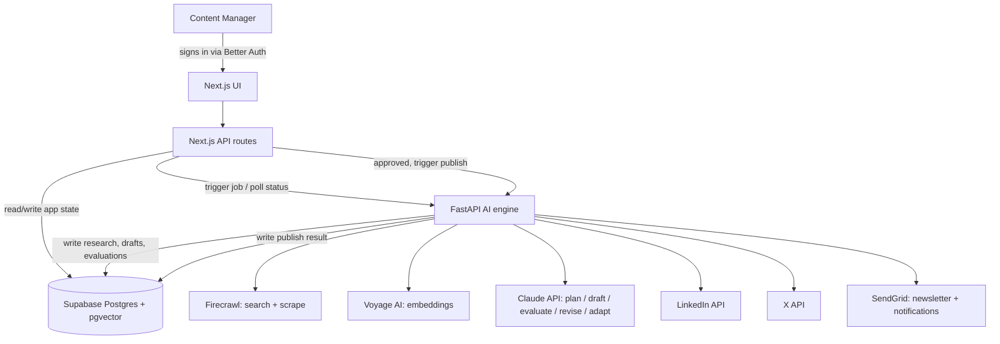

# Technical Design Document: AI Content Research and Publishing Agent

Companion to `PRD.md`. This document fixes the architecture, data model, and pipeline behavior so implementation has a single, unambiguous target.

## 1. Goals & Non-Goals

**Goals** (from the PRD): take a content request (idea and/or source URL + target audience) through research → source-grounded drafting → self-evaluation/revision → channel adaptation (LinkedIn, X, email newsletter) → human approval → publishing/scheduling, with full traceability back to source material and clear failure surfacing at every stage.

**Non-goals for this build:**
- Multi-tenant or multi-organization support (one content team, one set of connected publishing accounts).
- Role-based permissions beyond "logged in" (any authenticated user can act on any request).
- Historical analytics/reporting dashboards.
- Proactive or scheduled content ideation ("go find something to write about") — every pipeline run is triggered by an explicit content request.

## 2. High-Level Architecture

Two services share one Postgres database:

- **Next.js (TypeScript)** — the application layer. Owns the UI, authentication (Better Auth), request intake, human review/approval, and orchestration of the Python worker.
- **Python + FastAPI** — the AI engine. Owns research, retrieval-augmented generation (RAG), drafting, evaluation, revision, channel adaptation, and every outbound third-party integration (Claude, Firecrawl, Voyage, LinkedIn, X, SendGrid).
- **Supabase Postgres + pgvector** — the shared source of truth for both services.



**Why a shared database instead of a full second API surface:** Python writes every AI artifact (sources, chunks, plans, drafts, evaluations, channel content, publish results) directly to Postgres. Next.js reads all of that directly for display and writes human decisions (approvals, edits, schedule times). Next.js only calls FastAPI over HTTP to *trigger* work — start research, trigger a revision, trigger channel adaptation, trigger a publish — and to poll job status. This avoids building and maintaining a duplicate CRUD API on the Python side.

**Approval gate lives in Next.js, publish execution lives in FastAPI:** Next.js is the only caller allowed to invoke FastAPI's publish-trigger endpoint, and it checks that the target's status is `approved` in Postgres before doing so. FastAPI itself performs the LinkedIn/X/SendGrid calls, organized behind a small `Publisher` interface:

```python
class Publisher(Protocol):
    def publish(self, channel_content: ChannelContent) -> PublishResult: ...

class LinkedInPublisher(Publisher): ...
class XPublisher(Publisher): ...
class EmailPublisher(Publisher): ...
```

Consolidating outbound third-party calls in FastAPI keeps every external credential and integration in one service; the `Publisher` interface means adding a future channel is one new class, not a change to orchestration logic.

## 3. Data Model (Supabase Postgres + pgvector)

| Table | Key columns | Purpose |
|---|---|---|
| `users` / `sessions` / `accounts` | (Better Auth's standard schema) | Authenticated identities; every "who did this" field elsewhere is a foreign key here. |
| `content_requests` | raw_idea, target_audience, supporting_material, source_url, additional_instructions, status, created_by → users.id | The intake record and pipeline state (§4). |
| `research_jobs` | request_id, stage, status (pending/running/succeeded/failed), error, started_at, completed_at | Backs the status polling Next.js needs; one row per pipeline run. |
| `sources` | request_id, url, title, author, published_at, raw_content, cleaned_content, metadata (jsonb), relevance_score, included, fetch_error | Every source considered, whether or not it was used. |
| `source_chunks` | source_id, chunk_index, chunk_text, embedding (vector) | Chunked + embedded source text for similarity search. |
| `content_plans` | request_id, plan_json (angle, outline, target keywords, sections) | The plan generated before drafting. |
| `article_drafts` | request_id, version, parent_draft_id, variant_label, title, body_markdown, status | Every article option and every revision, versioned via `parent_draft_id`. |
| `draft_sources` | draft_id, source_id, chunk_ids[] | Which sources/chunks informed a given draft — the grounding record. |
| `evaluations` | draft_id or channel_content_id, criterion_scores (jsonb), overall_status, unsupported_claims (jsonb), recommended_changes, created_at | One row per evaluation pass, per the rubric. |
| `channel_content` | draft_id (the *selected* article), channel (linkedin/x/newsletter), body, status, evaluation_id | Adapted content per channel. |
| `approvals` | target_type, target_id, decision (approve/reject/revise), reviewer_id → users.id, notes, created_at | Full human review/audit history. |
| `publishing_queue` | channel_content_id, channel, scheduled_at, status (queued/scheduled/published/failed), published_at, external_post_id, error | The single publishing queue the PRD requires. |
| `notifications` | recipient_id → users.id, type (review_ready/published/publish_failed), target_id, sent_at, error | Log of every notification email sent or attempted. |

## 4. Pipeline State Machine

`content_requests.status` moves through:

```
submitted → researching → planning → generating_options → evaluating
  → options_ready → selected → revising (≤2 auto-cycles) → channel_adapting
  → channel_review → approved → queued → published
                                        ↘ failed (from any stage)
```

Every transition is logged. Any stage can land in `failed` with a human-readable error surfaced in the Next.js UI rather than leaving the request stuck silently. Entering `options_ready` (article options ready for human selection) or `channel_review` (adapted channel content ready for approval) fires a "review ready" notification (§9).

## 5. Evaluation & Revision Loop

Every draft (article or channel content) is evaluated against `assets/content-evaluation-rubric.md` via a Claude structured-output call that returns exactly the rubric's fields: overall status (pass/revise/reject), per-criterion notes, unsupported/weak claims, and recommended changes.

- **pass** → advances to human review.
- **revise** → the pipeline automatically generates one revised draft incorporating the feedback, capped at 2 automatic cycles to prevent infinite loops.
- Still **revise/reject** after the cap → surfaced to the human reviewer instead of looping further.

Every version is preserved (`article_drafts.parent_draft_id` chains revisions) and every evaluation is preserved (`evaluations`), so the complete review history is inspectable in the UI — this is what PRD requirement 4 asks for.

## 6. Source Grounding

Every source that's fetched — whether from a submitted URL or from research search results — is stored verbatim (`sources.raw_content`) alongside cleaned text and metadata (title, author, publish date). Source text is chunked and embedded (Voyage AI embeddings) into `source_chunks.embedding`, retrieved by pgvector similarity search when building the context passed to Claude for planning and drafting. `draft_sources` records precisely which sources/chunks informed each draft, so the UI renders a "Sources used" panel on every article and every channel adaptation — this is the direct implementation of PRD requirement 3 ("show which sources informed the output").

Architecturally, Claude is never given open-ended "go research the internet" instructions — FastAPI controls what material Claude sees, so grounding is enforced by what's in context, not requested as a favor.

## 7. Channel Adaptation

Once an article is approved, FastAPI generates LinkedIn, X, and newsletter versions in one pass, each using `assets/channel-formatting-rules.md` as the system-prompt contract for that channel. Each adapted piece runs through the same evaluation rubric (§5) before reaching human review — channel fit and clarity are rubric criteria, not just prose-quality checks.

## 8. Publishing & Scheduling

`publishing_queue` is the single, inspectable publishing queue the PRD requires. Nothing enters it, and nothing is sent, until Next.js has confirmed `approved` status. A scheduler (APScheduler inside the FastAPI process) polls for due `scheduled` items and dispatches to the matching `Publisher`:

- **LinkedIn** — LinkedIn API (`w_member_social` scope), the single pre-connected org/profile.
- **X** — X API v2 tweet creation, the single pre-connected account.
- **Email** — SendGrid, sending the newsletter to a configured audience/list.

Each result updates `publishing_queue.status` / `external_post_id` / `error`, and fires a "published" or "publish failed" notification (§9). Failures are retryable from the Next.js UI, which re-invokes FastAPI's publish-trigger endpoint — nothing fails silently (PRD requirement 8).

**Risk called out explicitly:** LinkedIn and X posting access requires developer app review that can take time to obtain. If access isn't approved before the build deadline, this is a known limitation to state plainly in the one-page doc — never fake a "published" status without a real API success response.

## 9. Notifications

A small notification service in FastAPI sends SendGrid emails on three triggers:

1. Content enters `options_ready` or `channel_review` — "ready for review," to the request's creator.
2. A `publishing_queue` item reaches `published`.
3. A `publishing_queue` item reaches `failed`.

Every send attempt (success or failure) is logged to `notifications`, so a missing notification is itself debuggable rather than a silent gap.

## 10. Authentication

Better Auth is integrated into the Next.js app using email + password sign-in, backed by its Postgres adapter against the same Supabase database. All dashboard, review, and publish routes require a session. `approvals.reviewer_id` and `content_requests.created_by` reference real authenticated users, so the audit trail reflects real identities rather than free-text names. No per-user roles or permissions are enforced beyond "logged in" — matching the PRD's single-team scope.

## 11. Error Handling & Observability

Every stage — research, retrieval, generation, evaluation, the approval gate, publishing, and notifications — writes structured errors into the relevant row (`research_jobs.error`, `publishing_queue.error`, `notifications.error`) and Next.js surfaces them verbatim in the UI. This is a direct response to PRD requirement 8 ("make the failure clear enough to debug") and maps 1:1 onto the testing evidence table in §13.

## 12. Config & Secrets

| Variable | Used by | Purpose |
|---|---|---|
| `ANTHROPIC_API_KEY` | FastAPI | Claude API (planning, drafting, evaluation, revision, adaptation) |
| `FIRECRAWL_API_KEY` | FastAPI | Search + scrape |
| `VOYAGE_API_KEY` | FastAPI | Embeddings |
| `SUPABASE_URL` / `SUPABASE_SERVICE_KEY` | Both | Shared Postgres + pgvector |
| `LINKEDIN_ACCESS_TOKEN` | FastAPI | LinkedIn publishing |
| `X_API_KEY` / `X_API_SECRET` / `X_ACCESS_TOKEN` | FastAPI | X publishing |
| `SENDGRID_API_KEY` | FastAPI | Newsletter sends + notifications |
| `BETTER_AUTH_SECRET` | Next.js | Session signing |

## 13. Testing Plan Mapping

| # | PRD Scenario | Exercised by | Pass looks like |
|---|---|---|---|
| 1 | Raw idea request | Research (search-only path) → planning → generation | Multiple relevant article options produced from an idea alone, no URL needed. |
| 2 | URL-based request | Research (scrape path via Firecrawl) → RAG → generation | Content visibly draws on the extracted page content, not generic knowledge. |
| 3 | Research and source grounding | `draft_sources`, "Sources used" panel, evaluation's unsupported-claims check | UI shows exactly which sources informed the output; no claims trace to nothing. |
| 4 | Evaluation and revision loop | §5 evaluation/revision cycle, `article_drafts` version chain, `evaluations` history | Weak drafts are revised automatically (≤2 cycles) and the full history remains visible. |
| 5 | Human approval | Next.js approval gate before `publishing_queue` insert / publish-trigger call | No publish or schedule occurs without an `approved` status set by an authenticated reviewer. |
| 6 | Channel formatting | §7 channel adaptation against `channel-formatting-rules.md`, rubric's Channel Fit criterion | LinkedIn/X/newsletter outputs each follow their platform's rules. |
| 7 | Publishing or scheduling | §8 `publishing_queue` + `Publisher` implementations | Approved content is published, scheduled, or visibly queued — never lost. |
| 8 | Failure handling | §11 structured errors on every stage's table/row | Every induced failure (bad URL, API timeout, rejected draft, publish error) is visible and specific in the UI, not a silent stall. |

## 14. Open Items

- LinkedIn/X developer app approval lead time is unresolved as of this document — track separately and note as a limitation if not resolved before the build deadline.
- Whether `additional_instructions` on `content_requests` needs its own structured sub-fields (vs. free text) can be decided during implementation without affecting this architecture.
